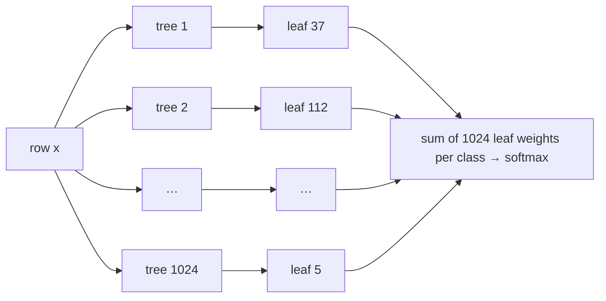

# Median trees

**Random trees cut at the median, one linear model on their leaves.** No tuning. On tabular data it is level with default gradient boosting; with many classes, and on frozen embeddings, it is clearly ahead, and much faster.

```python
from median_trees import MedianTreeClassifier

clf = MedianTreeClassifier().fit(X_train, y_train)
proba = clf.predict_proba(X_test)
```

scikit-learn compatible, handles missing values natively, CPU-parallel through Numba. Status: research release 0.1.

```bash
pip install git+https://github.com/twaitesjosh/median_trees
```

## The idea in one picture



1. **Build 1024 trees of depth 7 (128 leaves each).** At every node, the labels choose *which* feature to split on: the best of 6 candidates, half of them differences of two features. The data chooses *where*: the cut is always at the median of the rows in that node, never at a label-optimal threshold.
2. **Every row lands in one leaf per tree**, so it becomes a sparse vector with 1024 ones among 131,072 columns.
3. **One softmax model is fitted on those columns** with SGD (lock-free and parallel across cores for multiclass problems), dropout over trees, early stopping and tail averaging. The learning rate is found automatically.

There is no boosting: the trees are built once, independently, and the linear head decides how much every leaf is worth, for every class at once.

## Why cut at the median

A median split sends half the rows each way, so every leaf of every tree holds about n/128 training rows. That has three consequences:

- **Every leaf weight is estimated from enough data.** No three-row leaves with noisy weights, no leaves wasted on empty space.
- **The cells follow the data's density**, small where data is dense and large where it is sparse, like the neighbourhoods of k-nearest-neighbours. A forest of such partitions acts as an adaptive-bandwidth similarity kernel.
- **Cuts depend on ranks, not values**, so a feature's scale or a few extreme values cannot pull a split into empty space.

In our ablations, cutting at random *values* within each feature's range, as extremely randomized trees do, lost most of this: on skewed features most cuts land where there is no data. Moderately jittered quantiles (anywhere between the 25th and 75th percentile) did about as well as the exact median, so what matters is cutting through the data, not exact balance.

## Results

All comparisons use library defaults for every model unless stated otherwise. Full tables: [public suites](benchmarks/results/public_suites.md), [embeddings](benchmarks/results/embeddings.md), [overnight battery](benchmarks/results/overnight_report.md).

### Tabular benchmarks: level with gradient boosting

Official OpenML splits on three public suites, compared with scikit-learn's `HistGradientBoostingClassifier` (HGB):

| suite | datasets | median trees | HGB | won / tied / lost vs HGB |
|---|---|---|---|---|
| OpenML-CC18 | 69 | 86.91 | 86.74 | 33 / 7 / 29 |
| TabArena-v0.1 (classification) | 34 | 86.79 | 86.72 | 16 / 8 / 10 |
| Grinsztajn et al. 2022 (classification) | 15 | 76.44 | 76.51 | 6 / 3 / 6 |

Mean test accuracy in %. None of the differences is statistically significant: this is a tie with default boosting, not a win. On CC18 and TabArena median trees had lower log-loss than HGB (0.388 vs 0.444 on CC18's multiclass tasks); on the binary Grinsztajn datasets they did not.

### Many classes: ahead, and faster

Gradient boosting grows one tree per class per round, so its cost grows with the number of classes. Median trees share every tree across all classes; only the linear head grows.

| data | classes | median trees | LightGBM | HGB | kNN | fit time: median trees / HGB |
|---|---|---|---|---|---|---|
| Devnagari characters (OpenML 40923) | 46 | **90.96** | 87.83 | 86.67 | 85.08 | 6 s / 148 s |
| synthetic | 100 | **69.49** | 60.37 | 59.69 | 68.71 | 15 s / 35 s |
| synthetic | 250 | **47.59** | too slow | too slow | 42.33 | 57 s / – |
| synthetic | 500 | **31.61** | too slow | too slow | 23.99 | 98 s / – |
| CIFAR-100, ResNet-18 embeddings | 100 | **69.47** (raw features on) | – | 29.31 | 61.26 | 25 s / 10 s |

One dataset per row; 21,000 training rows for the synthetic sets, 30,000 for Devnagari, 35,000 for CIFAR-100. On the 26-class letter and isolet datasets median trees and boosting were level (95.8 vs 95.7–96.0).

### Frozen embeddings: a strong, cheap head

On sentence embeddings (all-MiniLM-L6-v2) and image embeddings (ResNet-18), `MedianTreeClassifier(raw_features=True)` beat gradient boosting on all six datasets tested and beat a tuned logistic-regression probe on all six, at a fraction of its training time. A small MLP was better on emotion (73.6 vs 71.1) and ag_news (90.8 vs 90.3); kNN was better on the two text datasets with tight topic clusters. On the 9 MTEB classification datasets that finished: MLP 84.18, median trees 83.80, logistic regression 83.58, HGB 69.59.

### Where else it holds up

From the [overnight battery](benchmarks/results/overnight_report.md), 16 Grinsztajn datasets unless stated:

- **Rotated features:** best of six models after a random rotation of the feature space (76.4 vs 75.9 for HGB), thanks to the two-feature difference splits.
- **Heavy label noise:** with 40% of training labels flipped, 67.0 vs 65.1 for HGB and 64.9 for LightGBM (only logistic regression did better, 68.1). The median thresholds never look at labels, so noise cannot move them.
- **Streams with drift:** trees fixed after a warm-up, only the head updated online: 84.2% prequential accuracy, level with retraining gradient boosting on a sliding window (84.9%) without ever retraining a tree; best of all methods on the final quarter of the streams (83.5%).
- **Defaults:** every one-at-a-time change to depth, tree count, dropout, oblique fraction, candidates or sample size moved accuracy by less than one point.

### Where it doesn't: use something else

- **Small tables (≤ 10,000 rows):** TabPFN was best at every size and CatBoost second. At 1,000 rows: TabPFN 77.8, CatBoost 76.9, tuned LightGBM 76.5, median trees 75.6, HGB 75.7.
- **Many useless features:** with 200 pure-noise columns added, 72.9 vs 77.9 for HGB. Random candidate features are mostly noise then.
- **Extreme class imbalance:** at a 1% minority rate, PR-AUC 13.5 vs 22.0 for CatBoost and 19.4 for HGB.
- **Large, few-class tables, when speed matters:** 300,000 rows and 2 classes took 23 s against 0.6–0.7 s for LightGBM and XGBoost. Prediction is also slower.
- **Seed stability:** 4.1% of test predictions change between random seeds (HGB 1.8%).
- **Unlabelled data does not help:** building the trees on unlabelled rows as well, with labels for only 1–30% of them, was slightly worse than building them on the labelled rows alone.

## When to use it

- Classification with **dozens to hundreds of classes**.
- A **classifier head on frozen embeddings** from a text or image model: stronger than gradient boosting, cheaper than a tuned probe.
- **Tabular data where you want a strong model without tuning**, on par with default boosting.
- **Streams**, where updating a linear head is cheaper than retraining trees.

For small tabular datasets use TabPFN or CatBoost; for very large tables with few classes, LightGBM or XGBoost.

## Reproduce

```bash
pip install -e ".[bench]"
python benchmarks/benchmark_suites.py --suites cc18,grinsztajn,tabarena,mteb
python benchmarks/embeddings_experiment.py
nohup python benchmarks/overnight.py < /dev/null > overnight.log 2>&1 &    # ~12 h; resumable
python benchmarks/overnight.py --summary
```

The benchmark scripts set every median-tree option explicitly, so their results do not depend on the package defaults.

## Layout

```
src/median_trees/       the package (MedianTreeClassifier, MedianTreeEmbedder, LeafSGD)
tests/                  pytest suite
benchmarks/             benchmark harnesses and results/
examples/quickstart.py  46-class handwriting: median trees vs gradient boosting
```

## Citation

See [CITATION.cff](CITATION.cff).

## License

BSD 3-Clause.
